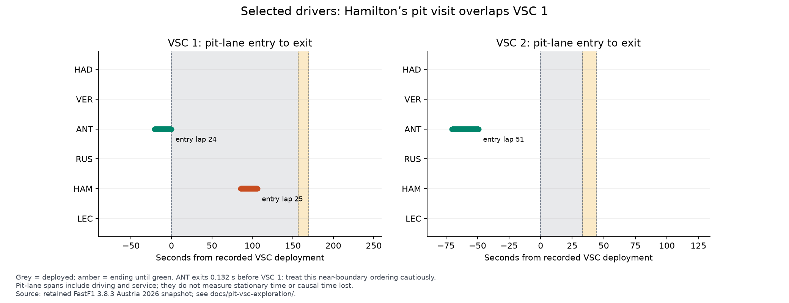
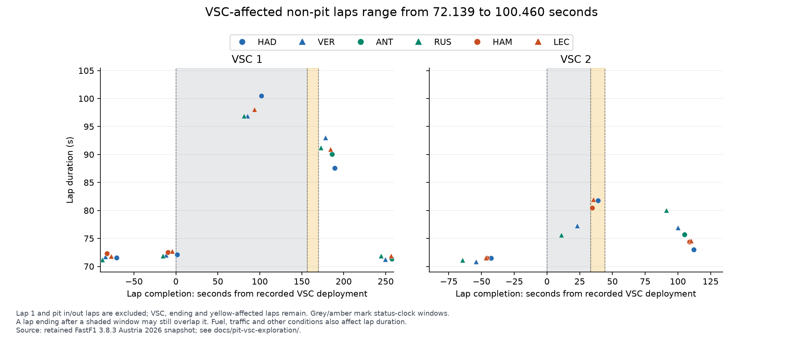
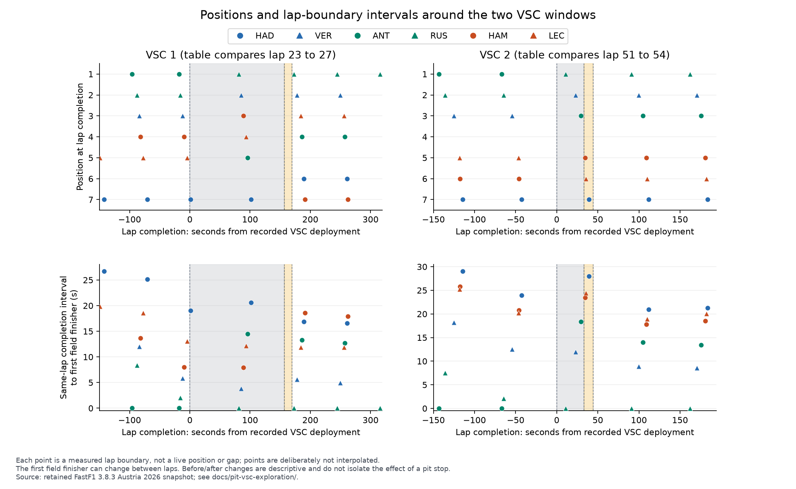

# Pit-stop timing and Virtual Safety Car exploration

This is the issue #7 exploration for the six selected Austria 2026 drivers. It connects recorded pit entries and exits with track-status timestamps, retains interruption-affected laps, and describes positions and validated lap-boundary intervals around the events. It does not establish which strategy was best.

## Reproduce offline

Use the pinned requirements and the original snapshot in `data/raw/austria-2026/`, including `laps.csv`, `track_status.csv` and `race_control_messages.csv`:

```powershell
& ".\.venv\Scripts\python.exe" scripts\explore_pit_vsc.py
& ".\.venv\Scripts\python.exe" -m unittest discover -s tests -v
```

Hayden can use `C:\venv\f1-pr-review\Scripts\python.exe` for the full suite. The script uses no network requests. It checks the retained laps hash against the audit, records hashes for all analysis inputs, and writes the same summary, two comparison tables and three figures. Raw hashes use exact bytes; prepared CSV hashes normalize CRLF to LF to accommodate Git checkout settings. Raw files remain ignored by Git. The committed outputs can be read without the snapshot.

## Event reconstruction

Track-status `Time` is a session-relative timestamp. Race-control message `Time` comes from UTC; it must not be subtracted directly from session seconds. These formats and status codes are defined in the [FastF1 3.8.3 parser](https://github.com/theOehrly/Fast-F1/blob/v3.8.3/fastf1/_api.py).

Use code 6 for deployment, code 7 for ending, and the following code 1 for clear. The ending phase remains inside the analysis window until green. Intervals are half-open: `[deployment, clear)`. A pit exit exactly at deployment has zero overlap. The script rejects missing, repeated or out-of-order transitions.

| Event | Deployment, session s | Ending, session s | Clear, session s | Deployed duration, s | Deployment to clear, s |
| --- | ---: | ---: | ---: | ---: | ---: |
| VSC 1 | 5202.549 | 5359.277 | 5372.352 | 156.728 | 169.803 |
| VSC 2 | 7251.463 | 7284.728 | 7295.694 | 33.265 | 44.231 |

The four DEPLOYED/ENDING race-control messages are paired by transition order. A median UTC-minus-session offset gives a maximum residual of 0.229 s and an offset spread of 0.451 s, consistent with these retained messages' whole-second timestamps. This is an approximate clock/sequence cross-check from the same retained source, not independent timing validation or a measured error bound. Pit overlap decisions use the session-relative track-status and pit timestamps, not fitted UTC values.

Timestamp overlap identifies exactly the same 25 driver-laps as the prepared `HasVSC` flags. The first event overlaps HAD's laps 24–26, but laps 25–26 for the other five drivers. The second overlaps laps 52–53 for all six. A single global affected-lap range therefore needs qualification when used for individual drivers.

## Pit visits: whole-lap flags and timestamp overlap differ

There are 14 recorded pit visits. Three have VSC flags somewhere on an entry or exit lap, but only one has positive timestamp overlap with the reconstructed windows. This count concerns the selected six drivers, not the entire field.

| Driver and visit | Entry, session s | Exit, session s | Status at entry/exit | Recorded relationship |
| --- | ---: | ---: | --- | --- |
| ANT, entry lap 24 | 5181.234 | 5202.417 | Yellow / yellow | Exit is 0.132 s before VSC 1 deployment; near-boundary case |
| HAM, entry lap 25 | 5287.856 | 5309.031 | VSC / VSC | Entire 21.175 s pit-lane span is inside VSC 1 |
| ANT, entry lap 51 | 7180.957 | 7202.506 | Clear / clear | Exit is 48.957 s before VSC 2 deployment |

ANT's exit laps subsequently encounter VSC, which explains their whole-lap flags without making the earlier pit-lane spans VSC stops. The first ANT visit is only 0.132 s from the recorded boundary: do not present that ordering as a physically precise or robust conclusion. A one-second proximity flag identifies it for sensitivity review; one second is a stated analytical caution rule, not an estimated source accuracy. Moving deployment one second earlier would change that visit's overlap classification. The second ANT visit is much farther from the boundary.

All 14 visits, their nearest boundary distances and before/after observations are in [pit_event_comparisons.csv](pit_event_comparisons.csv). Those before/after rows compare the completed lap before the in-lap with the completed out-lap. `IntervalChangeSeconds` covers that multi-lap window; it is not stationary service time, pit-stop time loss or time gained because of VSC.



## Lap times: keep affected observations visible

Excluding lap 1 and pit in/out laps leaves 21 VSC-affected observations, ranging from 72.139 to 100.460 s. HAD's lap 25 is 100.460 s. Removing those laps from a VSC comparison would remove the slowdown being investigated.

The lap-time panels show completions from 90 s before deployment to 90 s after clear. All 21 affected non-pit laps reach the plotting data. A point can finish after the shaded window and still represent a lap that overlapped it. Affected laps are retained as event observations even when they are ineligible for normal-racing pace comparisons.

Each cell below is **VSC / eligible normal pace / other non-pit** sample counts for the panel. Other samples can include yellow or accuracy-flagged laps. Small counts and uneven coverage preclude a controlled pace comparison; ANT has no eligible normal-pace sample in the second panel.

| Driver | VSC 1 panel | VSC 2 panel |
| --- | --- | --- |
| HAD | 3 / 1 / 0 | 2 / 1 / 0 |
| VER | 2 / 2 / 1 | 2 / 1 / 0 |
| ANT | 1 / 1 / 0 | 1 / 0 / 0 |
| RUS | 2 / 2 / 1 | 2 / 1 / 0 |
| HAM | 0 / 1 / 1 | 2 / 1 / 0 |
| LEC | 2 / 2 / 1 | 2 / 1 / 0 |

HAM has no non-pit affected sample in the first panel because his two affected laps are pit in/out laps, not because he is missing from the source. All his laps remain in the selected dataset and the position/interval view.



## Positions and same-lap completion intervals

For each event, choose a common completed lap that every selected driver finished before deployment, then a common lap that every driver started after clear. This gives laps 23 → 27 for VSC 1, and 51 → 54 for VSC 2. Each comparison uses the same lap numbers across all drivers. The full twelve-row table is [event_lap_comparisons.csv](event_lap_comparisons.csv).

Across the first comparison window, ANT changes from P1 to P4, RUS from P2 to P1, and HAM from P4 to P7. Across the second, ANT changes from P1 to P3, RUS from P2 to P1, and HAM from P6 to P5. These are descriptive window observations: they include pit sequences, racing laps and other drivers' actions. In particular, ANT's pit visits begin before the respective VSC deployments. Do not attribute these changes solely to the VSC or a pit decision.

The interval reference is the earliest field completion of the same lap, validated in [issue #4's report](../timing-validation/README.md). The first finisher can change between laps, so an interval change also reflects a changing reference. The plot uses individual lap-completion points and deliberately avoids interpolation into live gaps or positions. Track-status shading uses recorded session timestamps, rather than imposing one lap-number window on every driver.



## Design alternatives and limits

A whole-lap pit/VSC heatmap would be compact but would label all three flagged visits alike. Timestamp-scaled pit spans reveal why two do not overlap in the retained clock and why one is a boundary-sensitive case. A whole-race position line is useful for overview; the event panels make local observations easier to inspect, at the cost of broader race context. A live-gap replay would be more visually continuous but would imply measurements that this lap-boundary dataset does not provide.

Keep driver labels and distinct teammate shapes alongside consistent team colours. Both VSC lap-time panels share a full-range axis, so slower observations remain visible. These are exploratory figures for later audience testing and design selection, not final evidence of an optimal strategy. Fuel load, traffic, tyres, yellow flags, timing processing and other drivers' stops remain alternative explanations. Independent verification in #4 covers the finish only, not every event timestamp. No new telemetry, stationary-stop measurements or counterfactual stop-loss estimate has been added.

## Validation and review

All 37 tests pass with the original snapshot. New checks cover ending-to-green restrictions, touching versus crossing boundaries, missing/out-of-order transitions, inconsistent UTC pairs, the ANT/HAM distinction, retention of all 21 affected non-pit plotting rows, common-lap comparisons, and reproduction of the committed summary. All three figures were visually inspected. Review and merge remain separate: Roy is the primary reviewer, and Sebastian is also requested; #7 stays open until review is complete.
