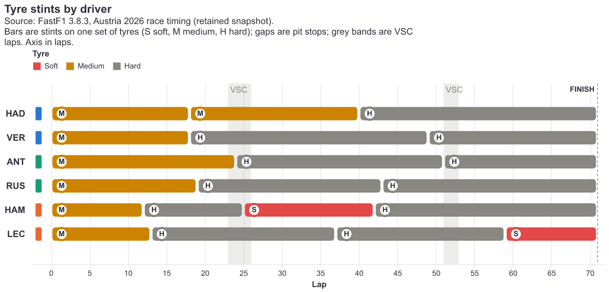
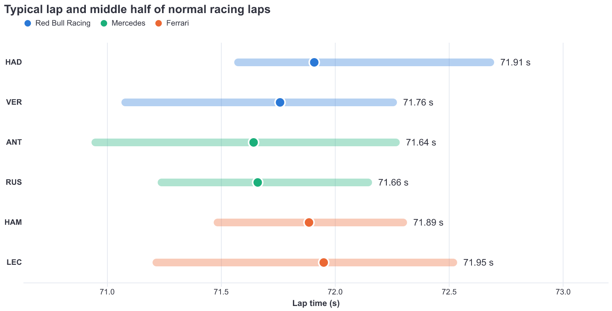
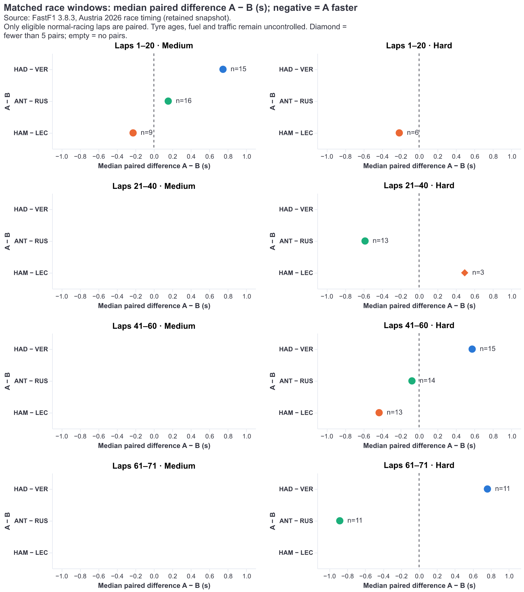
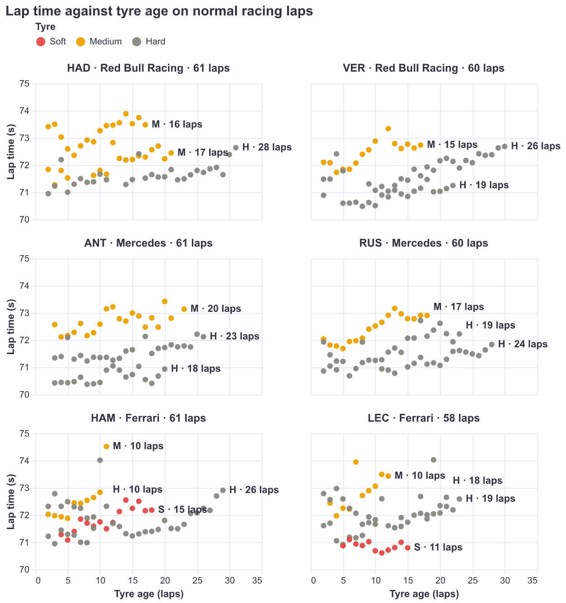

# F1 Strategy Visualisation draft visual report

Draft for review; audience feedback and pending story/accessibility corrections are not complete.

## Project purpose and audience

Draft visual report. This is current work for incremental submission, not a completed final package. It uses the merged dashboard and evidence at the repository version recorded in the references. Audience sessions are still pending, and the separate story/accessibility changes in PR #22 are not included.

Our project explains the 2026 Austrian Grand Prix for F1 fans who recognise the teams and basic rules but do not routinely analyse timing. Fans and motorsport content creators are stakeholders. Viewers should be able to question pace and pit-stop claims using the recorded evidence, rather than infer strategy from finishing positions alone.

### Research questions

1. How do lap times and pace consistency differ between the six selected drivers during comparable normal racing conditions?

2. How does lap time vary with tyre age within a stint, and how do patterns differ by driver and compound?

3. How do lap-boundary intervals and positions change around pit stops?

4. How do Virtual Safety Car periods affect the interpretation of pace and pit-stop comparisons?

The core scope is one race and both drivers from Red Bull Racing (HAD, VER), Mercedes (ANT, RUS) and Ferrari (HAM, LEC). Further races, teams and drivers are possible extensions after this core story is complete. We do not estimate an optimal strategy or causal tyre degradation.

## Data source and preparation

The retained snapshot was accessed on 8 October 2026 through FastF1 3.8.3. The main unit is one driver lap. The source contains 1,339 field laps; our selected data retain all 426 laps for six drivers, 71 each. There are 14 pit visits and 20 tyre stints. Telemetry was not downloaded (F1 Strategy Visualisation Group, 2026).

Core lap time, completion time, compound, tyre age, position and stint fields are complete, with no duplicate driver-lap keys. Sector 1 is missing on the six first laps. Empty pit timestamps normally mean no pit event and are not imputed. All selected records remain available; no slow laps are trimmed.

Normal-racing pace eligibility excludes first laps, pit entry/exit laps, non-green status, deleted/generated laps and accuracy-flagged observations. It retains 361 laps and excludes 65. The 55 accuracy flags are a different count and must not be treated as the full exclusion total.

Timing durations and session timestamps are converted to seconds and kept distinct. Driver, team, compound and stint identifiers are nominal; position and race lap are ordered; tyre age and durations are quantitative; event timestamps are temporal. No geographic variable is used.

### Prepared data preview

| Driver | Lap | Compound | Tyre age | Lap time (s) |
| --- | --- | --- | --- | --- |
| ANT | 3 | MEDIUM | 3 | 72.568 |
| HAD | 2 | MEDIUM | 2 | 73.413 |
| HAM | 2 | MEDIUM | 2 | 72.028 |

Prepared files and reproducible code are versioned. The raw snapshot stays local, identified by its audit hash. Event-clock alignment uses session-relative times; UTC race-control timestamps are not directly subtracted from session seconds.

## Provisional message and supporting evidence

### Main message

At Austria 2026, interpreting pit-stop timing requires the recorded event clock. A VSC flag on a pit-entry or pit-exit lap does not by itself show that the pit visit occurred during a Virtual Safety Car period.

### Finding 1: Whole-lap flags and timestamp overlap differ

Three of the 14 selected pit visits have a VSC flag on an entry or exit lap; only Hamilton’s lap 25 visit has positive recorded overlap. Its entire 21.175-second pit-lane span lies within VSC 1. Antonelli’s lap 24 exit is only 0.132 seconds before recorded deployment, so its ordering is boundary-sensitive (F1 Strategy Visualisation Group, 2026).

### Finding 2: Whole-race pace hides changing comparisons

Antonelli’s whole-race eligible median is 71.644 seconds and Russell’s is 71.662 seconds. Across 16 matched Medium pairs in laps 1–20, Antonelli is 0.155 seconds slower; across 11 matched Hard pairs in laps 61–71, he is 0.883 seconds faster, with tyres eight recorded laps younger. These are medians of paired differences, not differences between whole-race medians.

### Finding 3: Counts and event context change interpretation

The VSC affects 25 selected laps, including 21 non-pit lap-time observations. Hadjar’s lap 25 takes 100.460 seconds. Hamilton’s used Soft set begins at recorded age 3 and supplies 15 eligible observations from 17 recorded stint laps. Recorded tyre age, stint length and eligible sample size answer different questions.

These findings are descriptive. Fuel, traffic, track evolution, tyre history and other cars’ actions remain alternative explanations. One race and six drivers cannot establish a generally superior strategy.

## Visualization 1: Tyre stint overview



Task: identify tyre sequences, boundaries and stint lengths for individual drivers. Group all selected laps by driver and stint, retaining compound and first/last race lap. Consecutive same-compound sets remain separate; no pace exclusion is applied to stint accounting.

Marks and channels: rectangles represent sets; horizontal position and length encode lap coverage; rows identify drivers. Colour is reinforced by letters. Visual gaps separate sets but do not measure pit-stop duration (F1 Strategy Visualisation Group, 2026).

Why this form: the common lap axis preserves sequence. A stacked compound total would hide order and boundaries; team averages would hide teammate differences.

Limit: length is recorded use, not wear or speed. Shading identifies affected lap ranges, not exact clock boundaries. Use Visualization 4 for recorded pit/VSC overlap and the tyre-age table for used-set and eligible-count context.

## Visualization 2: Comparable driver pace



Task and transformation: compare eligible driver medians, quartiles and counts, then pair teammates on the same race lap and compound within fixed windows. The matched evidence contains 126 pairs across 11 groups (F1 Strategy Visualisation Group, 2026).

Marks and channels: points encode medians, horizontal segments show the middle half and rows identify drivers. Colour and teammate shapes preserve identity. Matched panels add a zero rule, paired differences and counts.

Why this form: a shared position scale supports precise comparison and retains spread. A mean bar would hide the distribution; density plots introduce smoothing choices to small, mixed samples.

Limit: whole-race summaries mix compounds, ages and phases. A shorter range is not proof of more consistent driving under equal conditions. Matching still leaves tyre age, fuel and traffic uncontrolled.

## Visualization 2: Matched race-window evidence



Counts refer to matched lap pairs. Diamonds flag fewer than five pairs as a reading caution, not a significance test. The dashboard table supplies the minimum and maximum tyre-age difference using the same A − B direction; these ranges are not confidence intervals.

## Visualization 3: Lap time and tyre age



The audience task is to inspect within-stint patterns. Each point is an eligible lap; position encodes recorded tyre age and lap time, and colour plus stint labels identifies the set. The accompanying dashboard table retains all recorded stints and their eligible counts.

Points avoid drawing through excluded observations. A pooled trend would mix sets and race phases. Tyre age rises with race lap, so fuel burn and track evolution cannot be separated here; neither a fitted slope nor a point pattern measures physical wear (F1 Strategy Visualisation Group, 2026).

## Visualization 4: Pit visits and the VSC clock


Question and audience task: distinguish a pit visit that overlaps the recorded VSC period from one whose entry or exit lap merely has a VSC flag. The dashboard includes all 14 visits and their elapsed times; the event panels provide a closer clock view.

Data and transformation: pair each pit entry with its driver’s exit, then check overlap from recorded VSC deployment until racing resumes, including the ending phase. Preserve the common session clock and flag visits within one second of a boundary for sensitivity review.

Marks and channels: horizontal segments or rectangles show pit spans; position encodes session seconds; shaded bands and vertical rules identify status transitions. Driver rows, colour and text preserve identity.

Why this form: a whole-lap heatmap would classify three visits alike and conceal their different recorded timing. The clock view exposes the one overlapping visit and Antonelli’s 0.132-second proximity. One second is an analytical caution rule, not a measured timing-error bound (F1 Strategy Visualisation Group, 2026).

Interpretation limit: elapsed pit-lane time includes travel and service. It is neither stationary service time nor a causal estimate of time lost or gained by stopping.

## Visualization 5: Event context and observed changes


The audience compares lap time, position and interval observations around recorded events. Points encode individual completions; status bands encode clock time. An affected lap can finish after a band ends. The common before/after laps are 23–27 and 51–54, but changes also include pit activity and racing. A continuous live-gap replay would imply unavailable measurements; no causal VSC gain is estimated.

## Story design and evaluation

The sequence starts with tyre-use context, moves from whole-race pace to matched comparisons and individual tyre sets, then explains pit/VSC timing and event observations. A supplementary positions view provides wider race context. The main message remains provisional until the group completes its audience and interpretation review.

### Expressiveness and effectiveness

Separate driver rows avoid implying that team averages describe both teammates. Quantitative comparisons use position and length; categories use labels, colour and shapes. The event panels retain slow observations and recorded timing boundaries rather than interpolate live values. The smaller samples and uncontrolled conditions remain visible in text and tables.

### Audience feedback still to be completed

Ask F1 fans outside development to explain each view before receiving help. Record anonymous participant codes, viewing context, exact version, their words, time to main point and confusing elements. Include the matched-pace selection and check tyre age versus wear, pit-lane time, lap-boundary intervals and affected laps outside shading. Keep unaided responses separate from later explanations.

For each response, record the design change, rejection or deferral and its reason, then repeat the affected task. No audience sessions or demonstrated comprehension improvements are claimed in this report. The one-minute reading goal is a target, not a measured outcome.

### Technical verification and outstanding review

The merged integration passed 88 local tests with the retained snapshot and Node rendering, and PR CI passed. These checks support recorded values and behaviour, not separate human interpretation. PR #22’s story/accessibility work remains outside this baseline; its contrast and accessible-title findings must be resolved before final accessibility claims are made.

## Reproduction and completion plan

The public repository includes prepared CSVs, processing and plotting code, a README and static figures. Raw snapshots, environments and credentials stay out of Git. Use the retained snapshot for full offline reproduction rather than assuming a fresh download is available.

```powershell
python -m pip install -r requirements.txt
python -m streamlit run app/story.py
python scripts/export_figures.py
python scripts/explore_pace_tyres.py
python -m unittest discover -s tests -v
```

For snapshot checks, place the original files in data/raw/austria-2026/, then run prepare_race.py with --from-snapshot, validate_timing.py and explore_pit_vsc.py from scripts/. Without the raw snapshot, raw-dependent tests may skip. The event investigation also needs the retained track-status and race-control files.

### Team responsibilities and review

Hayden leads development and integration, Roy leads the pace/tyre analysis and Sebastian supports the interface, story and testing. These are working responsibilities, not a final contribution assessment. Hayden reviews Sebastian, Roy reviews Hayden and Sebastian reviews Roy. Both other members are requested on each PR; one eligible approval is required.

### Before the final package

Resolve and merge the pending story/accessibility corrections, complete actual audience sessions and record resulting decisions, review the complete static sequence against the dashboard, and confirm the final message together. Each member must complete their own reflection and contribution record and be able to defend every major decision.

Additional races, teams and drivers remain optional. Extend only after checking source coverage, compatibility and available time; an extension should test a meaningful comparison rather than enlarge the charts without a question.

## References

1. F1 Strategy Visualisation Group (2026) *Audience and stakeholder brief*. [Versioned source](https://github.com/haydenteh5526/F1-Strategy-Visualisation/blob/f29be98403f5d28ef1d2859fdc35a7c71825a350/docs/audience-brief/README.md).

2. F1 Strategy Visualisation Group (2026) *Austria 2026 data audit*. [Versioned source](https://github.com/haydenteh5526/F1-Strategy-Visualisation/blob/f29be98403f5d28ef1d2859fdc35a7c71825a350/data/processed/austria-2026/audit_summary.json).

3. F1 Strategy Visualisation Group (2026) *Austria 2026 preliminary pace and tyre exploration*. [Versioned source](https://github.com/haydenteh5526/F1-Strategy-Visualisation/blob/f29be98403f5d28ef1d2859fdc35a7c71825a350/docs/pace-tyre-exploration/README.md).

4. F1 Strategy Visualisation Group (2026) *Austria 2026 timing investigation*. [Versioned source](https://github.com/haydenteh5526/F1-Strategy-Visualisation/blob/f29be98403f5d28ef1d2859fdc35a7c71825a350/docs/timing-validation/README.md).

5. F1 Strategy Visualisation Group (2026) *Dashboard integration*. [Versioned source](https://github.com/haydenteh5526/F1-Strategy-Visualisation/blob/f29be98403f5d28ef1d2859fdc35a7c71825a350/docs/dashboard-integration.md).

6. F1 Strategy Visualisation Group (2026) *Pit-stop timing and Virtual Safety Car exploration*. [Versioned source](https://github.com/haydenteh5526/F1-Strategy-Visualisation/blob/f29be98403f5d28ef1d2859fdc35a7c71825a350/docs/pit-vsc-exploration/README.md).
